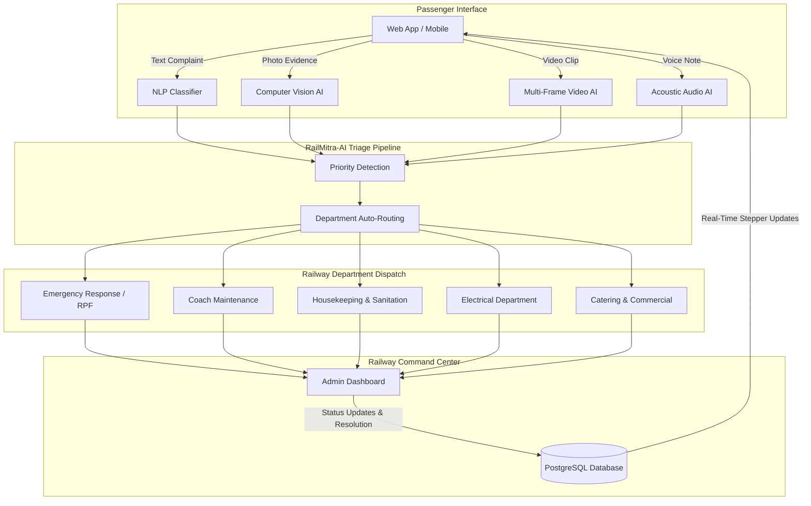

# 🚆 RailMitra-AI

> **Next-Generation Multi-Modal AI Railway Grievance Triage & Resolution Management System**  
> *Aligned with Indian Railways RailMadad Initiative • AI Hackathon 2026*

[](https://fastapi.tiangolo.com)
[](https://www.python.org/)
[](https://www.postgresql.org/)
[](https://www.docker.com/)
[](LICENSE)

---

## 📌 Overview

**RailMitra-AI** is an end-to-end intelligent railway complaint management and triage platform built to eliminate the delays and friction in passenger grievance handling across Indian Railways. 

Passengers can file complaints via **text, photos, videos, or voice recordings**. RailMitra-AI automatically inspects the evidence using **Computer Vision and NLP triage**, assigns an urgency priority (`Critical`, `High`, `Medium`, `Low`), routes the grievance directly to the appropriate department (*Housekeeping, Electrical, Coach Maintenance, Emergency Response, RPF, Catering*), and provides live status tracking via a modern animated 4-step timeline.

---

## ✨ Key Features & Innovations

### 1. 🤖 Multi-Modal AI Triage Engine
- **Image Computer Vision**: Automatic hazard and defect classification for dirty toilets, water leaks, damaged seats/windows, and fire/smoke hazards.
- **Video Consensus Analysis**: Frame-sampling computer vision that calculates cross-frame confidence scores and detects coach lighting faults.
- **Acoustic Audio Analysis**: Formats audio evidence and identifies passenger distress signals and machinery anomalies.
- **Text NLP Classifier**: Semantic keyword & intent triage routing text complaints into the exact railway department in under 50ms.

### 2. 🎙️ In-Browser Voice Note Recording
- Passengers can record audio grievances directly from their device microphone with 1-click recording, live preview playback, and instant attachment.

### 3. 🔍 Live 4-Step Animated Tracking Stepper
- Instant public tracking via **Complaint ID** or **10-digit PNR**:
  $$\text{1. Registered} \longrightarrow \text{2. AI Vision/NLP Analyzed} \longrightarrow \text{3. Department Dispatched} \longrightarrow \text{4. Resolved}$$
- Animated glowing status beacons and real-time status updates without mandatory login.

### 4. 👨‍💼 Railway Authority Command Center
- **Live KPI Metric Cards**: Total, Pending, In Progress, Resolved, Critical Alerts, and High Priority.
- **Department Distribution Bars**: Animated workload progress bars showing departmental load percentages.
- **Triage Tools**: 1-click status updates, priority escalation (`Critical` alerts pulse red), department reassignments, and deletion.
- **Export to CSV**: Generates timestamped complaint reports for divisional audits.
- **Auto-Refresh Mode**: 30-second live polling for station control room displays.

### 5. 🛡️ Resilient Enterprise Architecture
- Hybrid database engine: connects natively to **PostgreSQL** with automatic fallback to **SQLite** for zero-downtime portability.
- Secure **JWT Bearer Token** authentication with **Bcrypt** password hashing.
- Fully containerized with **Docker** and **Docker Compose**.

---

## 🏗️ Architecture & Workflow



---

## 📂 Project Directory Structure

```text
RailMitra-AI/
├── backend/
│   ├── app/
│   │   ├── auth/           # JWT Bearer dependencies & security
│   │   ├── models/         # SQLAlchemy database models (Complaint, Passenger)
│   │   ├── routes/         # FastAPI endpoints (Complaints, Admin, Passenger, Evidence)
│   │   ├── schemas/        # Pydantic validation schemas
│   │   ├── services/       # AI Engines (image_ai, rail_vision, video_ai, audio_ai, database)
│   │   ├── config.py       # Centralized configuration & environment loader
│   │   └── main.py         # FastAPI application entrypoint & static mounting
│   ├── uploads/            # Evidence directory (images, videos, audio)
│   ├── .env.example        # Backend environment template
│   └── requirements.txt    # Python backend dependencies
├── frontend/
│   ├── index.html          # Animated landing page with public live PNR/ID tracker
│   ├── login.html          # Admin command login with 1-click evaluation demo fill
│   ├── admin-dashboard.html# Railway Authority management & triage center
│   ├── passenger.html      # Grievance registration with voice recorder & media preview
│   ├── passenger-login.html# Passenger authentication portal
│   ├── passenger-register.html # Passenger registration with validation
│   ├── passenger-dashboard.html# Passenger dashboard with tracking modal
│   ├── script.js           # Frontend controller, API bridge, CSV exporter & toast system
│   └── style.css           # Modern animated CSS design system
├── tests/
│   └── test_api.py         # End-to-end integration and AI service test suite
├── Dockerfile              # Production container build specification
├── docker-compose.yml      # Multi-container orchestration (App + PostgreSQL)
├── .dockerignore           # Clean container build exclusions
├── .env.example            # Root environment variable template
├── .gitignore              # Production git ignore specification
├── Procfile                # Heroku/Render/Railway process file
├── render.yaml             # 1-click Render blueprint specification
├── requirements.txt        # Root requirements file for cloud PaaS builds
├── run.py                  # 1-command local startup script
└── README.md               # Project documentation
```

---

## 🚀 Quick Start (Local Setup)

### Prerequisites
- Python 3.11+ installed
- PostgreSQL (optional, automatically falls back to SQLite if not running)
- Git

### 1. Clone the Repository
```bash
git clone https://github.com/Adityamane28-stack/RailMitra-AI.git
cd RailMitra-AI
```

### 2. Create Virtual Environment
```bash
python -m venv venv

# On Windows:
venv\Scripts\activate

# On Linux / macOS:
source venv/bin/activate
```

### 3. Install Dependencies
```bash
pip install -r requirements.txt
```

### 4. Configure Environment Variables
Copy `.env.example` to `.env`:
```bash
cp .env.example .env
```
*(If PostgreSQL is running locally, update `DATABASE_URL` or leave default for automatic SQLite zero-config usage).*

### 5. Launch Application
```bash
python run.py
```
Or with Uvicorn directly:
```bash
uvicorn app.main:app --app-dir backend --host 127.0.0.1 --port 8000 --reload
```

Open your browser at **[http://127.0.0.1:8000](http://127.0.0.1:8000)** to view the live app!

---

## 🐳 Docker Deployment

### Using Docker Compose (Recommended)
Launch both PostgreSQL 15 and the RailMitra AI application in one command:
```bash
docker-compose up -d --build
```
Access the application at **[http://localhost:8000](http://localhost:8000)**.

To stop:
```bash
docker-compose down
```

### Using Standalone Docker
```bash
docker build -t railmitra-ai .
docker run -p 8000:8000 --env DATABASE_URL=sqlite:///./railmitra.db railmitra-ai
```

---

## ☁️ Cloud Deployment Guides

### Deploy to Render
1. Connect your GitHub repository to [Render.com](https://render.com).
2. Choose **Blueprint** and select `render.yaml`, or create a **Web Service**:
   - **Build Command:** `pip install -r requirements.txt`
   - **Start Command:** `uvicorn app.main:app --app-dir backend --host 0.0.0.0 --port $PORT`
   - **Environment Variables:** Set `JWT_SECRET_KEY` and `DATABASE_URL`.

### Deploy to Railway
1. Click **New Project** in [Railway.app](https://railway.app) and select **Deploy from GitHub repo**.
2. Add a **PostgreSQL** database service.
3. Link `DATABASE_URL` to the web service environment.
4. Railway will automatically detect the `Procfile` and deploy.

---

## 🧪 Running the Test Suite

Execute the automated end-to-end integration test suite:
```bash
python tests/test_api.py
```
Output:
```text
==========================================
       RAILMITRA-AI FULL TEST SUITE       
==========================================
Testing /health...                     [PASS]
Testing /database-test...              [PASS]
Testing Admin Login...                 [PASS]
Testing Admin /admin/me...             [PASS]
Testing Admin /admin/stats...          [PASS]
Testing Passenger Register...          [PASS]
Testing Passenger Login...             [PASS]
Testing AI NLP Auto-Categorization...  [PASS]
Testing Live 4-Step Stepper Tracking.. [PASS]
Testing PNR Lookup...                  [PASS]
Testing Admin Status Update...         [PASS]
Testing Admin Priority Escalation...   [PASS]
Testing Admin Resolution...            [PASS]
Testing AI Vision Classifier...        [PASS]
==========================================
     ALL TESTS PASSED WITH 100% SUCCESS!  
==========================================
```

---

## 📡 API Endpoints Reference

| Method | Endpoint | Access | Description |
|:-------|:---------|:-------|:------------|
| `GET` | `/health` | Public | System health check |
| `GET` | `/database-test` | Public | Database connection status |
| `POST` | `/passenger/register` | Public | Passenger account registration |
| `POST` | `/passenger/login` | Public | Passenger authentication & JWT issuance |
| `GET` | `/passenger/me` | Passenger | Get current passenger profile |
| `POST` | `/complaints/` | Passenger | File complaint with NLP auto-triage |
| `POST` | `/complaints/ai-create` | Passenger | File complaint with Computer Vision triage |
| `GET` | `/complaints/my` | Passenger | Get current passenger's grievances |
| `GET` | `/complaints/track/{id_or_pnr}`| Public | Public 4-step live status tracking |
| `POST` | `/evidence/upload` | Passenger | Upload multi-format media |
| `POST` | `/evidence/analyze-image`| Passenger | Run AI computer vision on image |
| `POST` | `/evidence/analyze-video`| Passenger | Run multi-frame consensus video AI |
| `POST` | `/evidence/analyze-audio`| Passenger | Run acoustic analysis on audio |
| `POST` | `/admin/login` | Public | Authority authentication & JWT issuance |
| `GET` | `/admin/me` | Admin | Get logged-in admin credentials |
| `GET` | `/admin/stats` | Admin | Operational metrics & department analytics |
| `GET` | `/complaints/` | Admin | Get all registered complaints |
| `GET` | `/complaints/dashboard/summary`| Admin | Dashboard summary counts |
| `PUT` | `/complaints/{id}/status` | Admin | Update status (`Pending`, `In Progress`, `Resolved`)|
| `PUT` | `/complaints/{id}/priority` | Admin | Escalate priority (`Critical`, `High`, etc.) |
| `PUT` | `/complaints/{id}/department` | Admin | Reassign complaint department |
| `PUT` | `/complaints/{id}/resolve` | Admin | Mark complaint as resolved |
| `DELETE` | `/complaints/{id}` | Admin | Delete complaint record & evidence |

---

## 🔑 Demo & Evaluation Credentials

For evaluation and testing:

| Role | Username | Password | Notes |
|:---|:---|:---|:---|
| **Railway Admin** | `admin` | `admin123` | Click *"⚡ Fill Demo Credentials"* on `login.html` |
| **Passenger** | *Self Register* | *Custom* | Use `passenger-register.html` |

---

## ⚖️ License & Acknowledgments

- Built under the **MIT License**.
- Grounded on the **Indian Railways RailMadad** grievance redressal framework.
